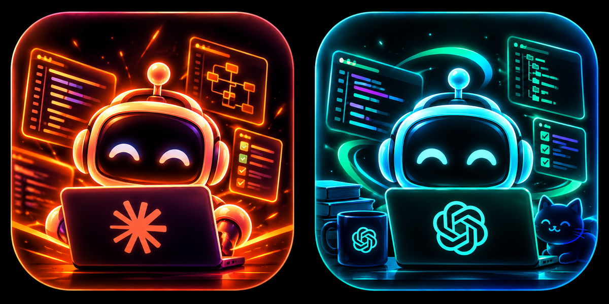

<p align="center">
  
</p>

<h1 align="center">discord-agent-presence</h1>

<p align="center">
  <a href="https://github.com/abelxmendoza/discord-agent-presence/releases/latest/download/AgentPresence-macOS.dmg"></a>
  <a href="https://abelxmendoza.github.io/discord-agent-presence/"></a>
  <a href="https://github.com/abelxmendoza/discord-agent-presence/actions/workflows/test.yml"></a>
</p>

Discord Rich Presence for AI coding tools. Discord already shows "Playing
Visual Studio Code"; this does the same for **Claude, ChatGPT / Codex, Gemini
CLI, GitHub Copilot CLI, Grok Build, Muse Code, OpenCode, Aider, Cursor,
Windsurf, Kiro and VS Code**, and adds which projects you're on, how many AI
agents are running, and what they're doing right now.

```
Watching Vibe Coding
▸ px4-autonomous-mission ✦ Omega-Code
  ↻ ⚡ 3 agents cooking · Claude 2 · Codex 1   (2 of 3)
  ↻ 🧪 running tests · px4-autonomous-mission
  ↻ ✅ tests passed
  ↻ ⏱ 3h 31m of agent time today · 💸 3.6M tokens
  ↻ 🌿 feat/sim-asset-pipeline · +159 −18
  ↻ 🔥 3-day streak · 📦 6 commits today
  ↻ 🧠 Opus 5.5 · ✅ CI green
[ ⭐ View on GitHub ]  [ 🤖 Get Agent Presence ]
```

Works on **Linux, macOS and Windows** with Python 3.9+. No Discord setup needed.

## Install

**macOS:** [**⬇ Download AgentPresence-macOS.dmg**](https://github.com/abelxmendoza/discord-agent-presence/releases/latest/download/AgentPresence-macOS.dmg), open it and
double-click **Agent Presence**, then click **Install**. No terminal, git or
Python setup: it brings what it needs and starts at every login. Apple silicon
and Intel, macOS 11+.

> **First time only:** macOS may say it can't check the app for malware,
> because it isn't from the App Store. Click **Done**, open **System Settings →
> Privacy & Security**, scroll down and click **Open Anyway** next to Agent
> Presence. Open the app again any time to **Update**, **Restart** or
> **Uninstall**. If your Mac has no Python yet, the app walks you through
> Apple's free Command Line Tools installer.

**Linux / macOS terminal**

```bash
curl -fsSL https://raw.githubusercontent.com/abelxmendoza/discord-agent-presence/main/install.sh | bash
```

**Windows** (PowerShell)

```powershell
irm https://raw.githubusercontent.com/abelxmendoza/discord-agent-presence/main/install.ps1 | iex
```

The installer downloads the tool, adds the `agent-presence` command and starts
it at every login. Linux needs no extra packages; macOS and Windows get
`psutil` in a private virtualenv. Other ways to install:

```bash
pipx install git+https://github.com/abelxmendoza/discord-agent-presence && agent-presence setup
# or from a clone:
git clone https://github.com/abelxmendoza/discord-agent-presence && ./discord-agent-presence/install.sh
```

| Command | |
|---|---|
| `agent-presence doctor` | Checks Discord, window detection, and which tools are installed |
| `agent-presence detect` | Previews every card, rotating line and image |
| `agent-presence setup` / `uninstall` | Adds / removes the login service (`setup --dry-run` to preview) |
| `agent-presence run` | Runs in the foreground |
| `agent-presence link` / `link <key>` / `link --off` | Shares one card across your computers |
| `agent-presence machines` | Shows this computer, your linked ones, and which one has the card |

| | Linux | macOS | Windows |
|---|---|---|---|
| Starts at login via | systemd user service | launchd agent | Startup folder |
| Window detection | `xprop` (X11) | System Events (needs Accessibility\*) | Win32 API |
| Logs | `journalctl --user -u ai-presence -f` | `~/Library/Logs/agent-presence.log` | `~\.local\state\ai-presence\agent-presence.log` |

\* On macOS, allow Accessibility for Python under System Settings → Privacy &
Security → Accessibility so it can read editor window titles. The Mac app's
**Allow Window Titles…** button opens that page and copies the Python path for
you. Without it everything else works; only projects that come from Cursor
or VS Code window titles are missed. `agent-presence doctor` tells you.

## What's on the card

- **Agents.** Each Claude Code session (desktop app, CLI or VS Code extension),
  Codex thread and Gemini CLI session counts, and so does each running Copilot,
  OpenCode, Aider, Grok or Muse CLI. An agent is "cooking" while it works and
  "waiting for me" once it finishes, asks you something, or sits on a
  permission prompt.
- **Live actions.** The agent's latest tool call becomes a line: ✍ editing
  foo.py, 🧪 running tests, 🔨 building, 🛸 running the sim, 🌐 researching,
  📦 committing, 🚀 pushing.
- **Pass / fail.** The newest test, build or push result, read from exit codes.
- **Projects.** Every project your agents and editor windows are in, shown as
  the git repo name, the one you're focused on first.
- **Git.** Branch and uncommitted +/− lines for the top project, commits today.
- **Today's stats.** Agent time and tokens since midnight. Tokens count new
  work (input + output + cache writes), not cache re-reads.
- **Streak, model and CI.** Days in a row with commits or an active card, the
  model in use, and GitHub CI status (public repos only).
- **Milestones.** For 10 minutes after they happen: 🎉 PR #42 merged,
  🏆 100th commit this month, 🏆 10th commit today, 🔥 new record: 12-day streak.
- **A card that renames itself.** "Coding" while you're typing, "Vibe Coding"
  while your agents do the work. The timer carries over when it switches.
- **Mood verb.** **Watching** while agents work and you're in another window,
  **Competing in** at 5+ agents, otherwise **Playing**.
- **Buttons.** Your repo on GitHub (public repos only) and "🤖 Get Agent
  Presence". Other people can click them; Discord hides buttons on your own card.

### One card for every tool

Out of the box, every tool shares one **combined card** on the built-in
"Coding" / "Vibe Coding" Discord apps. Its picture follows the tool you're
using (the focused one, else the one with the busiest agents), and its lines
cover every agent across tools.

Discord shows one card per Discord app. For a separate "Playing Cursor" card,
create an application at <https://discord.com/developers/applications> (its
name is what follows "Playing") and put its Application ID under
`client_ids.cursor` in the config. That tool then gets its own card and leaves
the combined one.

### Several computers

Each computer shows which machine it is and its OS: `💻 MacBook Pro · macOS 15`
(Raspberry Pi and Jetson boards are recognized too). Hover the big picture to
see the full OS version. Hostnames and serial numbers are never shown; set
`machine_name` to call it something else.

Run the tool on each computer, then link them with one key:

```bash
agent-presence link            # on the first computer: prints a key
agent-presence link <key>      # on each of the others
agent-presence setup           # restart on each to apply
```

Linked computers on the same network share **one card**. It sits on whichever
computer you touched last (keyboard or mouse) and moves about 15 seconds after
you switch, with a short `↪ moved to MacBook Pro` line. Every machine's agents
count toward the card, so it reads like:

```
⚡ 5 agents cooking · Claude 3 · Codex 2
🖥 2 machines: 💻 MacBook Pro (3) · 🖥 Alienware Aurora R16 (2)
🖥 Alienware Aurora R16: 2 agents cooking while I'm away
```

A machine without Discord open (a Jetson running agents over SSH, say) still
adds its agents but never shows the card itself. Machines share a small signed
packet over UDP port 47777 on your local network; the key stops other people's
computers from posting to your card. The first time, macOS asks to allow Python
to find devices on your local network, and Windows asks to allow it through
the firewall: say yes. Git lines, streaks and today's tokens come from the
computer showing the card. Linux reads keyboard/mouse idle time with
`xprintidle` if installed (`sudo apt install xprintidle`); without it the card
falls back to whichever Linux machine has the busiest agents.

### Images that change

Each card has two image slots:

- **Big picture:** the tool's mascot in its current mood: *cooking*, *crew*
  (3+ agents), *success* (tests or build just passed), *push*, *sim*
  (ROS 2 / Gazebo / PX4 running), *failed* (failing tests or red CI),
  *waiting*, or *idle*.
- **Small badge:** follows the rotating line: agent count, current action,
  branch, streak flame, model or CI status.

Every tool has all eight moods in [`images/`](images/). Missing files are
skipped, and forks can point `image_base_url` at their own art. See
[IMAGE_PROMPTS.md](IMAGE_PROMPTS.md) to make new art.

### Replacing Discord's own VS Code card

Discord detects VS Code on its own and shows a plain "Playing Visual Studio
Code" card with no project. Apps can't turn that off, so do it once: in
Discord, open **User Settings → Registered Games** (or **Activity Settings →
Registered Games**) and remove **Visual Studio Code**. If it comes back, turn
off sharing for *detected games* under Activity Privacy, and keep *Rich
Presence apps* on.

## Config

`~/.config/ai-presence/config.json` (created on first run):

| Key | Default | |
|---|---|---|
| `hide_projects` | `[]` | Shown as "private project", with no git, CI or button |
| `show_machine` | `true` | The computer / OS line, and which linked machines are in use |
| `machine_name` | `""` | What to call this computer; blank = its model |
| `link_key` | `""` | Same key on each computer = one shared card (`agent-presence link`) |
| `show_project`, `show_files`, `show_git`, `show_stats`, `show_streak`, `show_model`, `show_ci`, `show_milestones` | `true` | Turn each line on or off |
| `github_button`, `promo_button`, `mood_verbs` | `true` | |
| `client_ids` | shared apps | Per tool: your own Application ID, a list of IDs for several names, or `"off"`. `combined` is the shared card |
| `name_mode` | `"vibe"` | With several names: `"vibe"` (Coding / Vibe Coding) or `"rotate"` every `name_rotate_seconds` |
| `rotate_seconds` | `20` | How often the second line changes |
| `agent_active_seconds` / `agent_waiting_seconds` | `300` / `1800` | How long a working / finished agent stays counted |
| `crew_size` | `3` | Busy agents that switch the picture to *crew* |
| `success_mood_seconds` / `failed_mood_seconds` / `milestone_seconds` | `180` / `900` / `600` | How long those last |
| `images`, `image_base_url` | `"url"`, this repo | `"url"`, `"assets"` (keys uploaded to your Discord app) or `"none"` |

**Privacy:** everything on the card is visible to anyone who can see your
profile: project, branch and file names, and commit counts. Commit messages and
full paths are never shown, nor are hostnames. No code leaves your machine;
linked computers share only card-level status with each other on your local
network.

## Supported tools

| Tool | Detected from | Live actions | Pass / fail |
|---|---|---|---|
| Claude (desktop, Code CLI, VS Code ext.) | session logs in `~/.claude*/projects` | ✓ | ✓ |
| ChatGPT / Codex (desktop, CLI) | session logs in `~/.codex/sessions` | ✓ | ✓ |
| Gemini CLI (Google) | session files in `~/.gemini/tmp/*/chats` | ✓ | ✓ |
| GitHub Copilot CLI | process + its session folder's activity | — | — |
| OpenCode | process + its storage's activity | — | — |
| Aider | process + the project's `.aider.chat.history.md` | — | — |
| Muse Code (Meta), Grok Build (xAI) | process | — | — |
| Cursor, Windsurf, Kiro, VS Code | app process + window titles | — | — |

Copilot, OpenCode, Aider, Muse and Grok don't document a session log format,
so their contents aren't read. Each counts as working while it writes its files
or uses CPU, and as waiting otherwise. If you use one of these and something
looks off, please open an issue.

## How it works

- `/proc` (Linux) or `psutil` (macOS / Windows) lists apps and CLI agents with
  their launch times and working directories.
- `xprop`, System Events or the Win32 API gives the focused window and editor
  titles.
- Agent state, results and tokens come from the session logs above, read
  incrementally.
- Each card is its own connection to Discord's local IPC endpoint: a Unix
  socket, or a named pipe on Windows.

## Development

```bash
python3 -m unittest discover -s tests -v   # also runs in CI on Ubuntu, macOS and Windows
python3 ai_presence.py detect              # preview without touching Discord
python3 tools/make_tool_art.py cursor      # rebuild a tool's mood art from the Claude set
```

The Mac app is built by `macos/build_app.sh` (on a Mac) and the `macos-app`
workflow, which smoke-tests it and attaches the .dmg to each release. Set the
`MACOS_SIGN_IDENTITY` and `APPLE_*` repo secrets to sign and notarize it so it
opens without the Privacy & Security step.

The tests use synthetic session logs and a fake Discord server (Unix socket or
Windows named pipe). MIT licensed.
